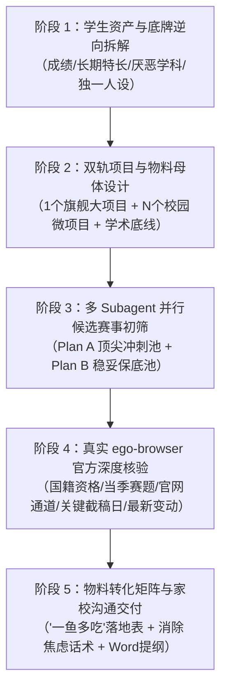

# 活动与竞赛精准挖掘与官方事实核查技能手册（Activity & Competition Scout）

本技能用于为国际高中生（特别是美本 Top 30 / Top 20 申请者）进行**活动与竞赛的精准挖掘、专业人设匹配、赛事实体物料转化，以及 100% 官方真实的资格与赛程核查**。

核心交付目标：
1. **绝不盲目套用营销号推荐**：通过真实浏览器 `ego-browser` 深度核查官方 Eligibility 手册，坚决排除非美籍不可参赛、政策变更或停办重组的赛事。
2. **拒绝学科偏科硬伤**：严格尊重学生偏好（如学生讨厌物理，坚决不碰硬物理，转向真实体态、UI/UX、视频、艺术与逻辑交叉）。
3. **“一鱼多吃”物料闭环**：赛事的提交物完全由设计好的项目自然生成，坚决不让学生“打一个比赛就重写一套完全不同的作业”。
4. **大项目与小项目双轨制**：1 个外部带做的硬核大项目（冲全球顶尖大奖）+ 4 个顾问亲带的校园小项目（保底获奖 + 文书血肉 + 真实防造假铁证）。

---

## 核心工作流总览（The 5-Stage Pipeline）



---

## 阶段 1：学生资产与底牌逆向拆解

在推荐任何活动或比赛前，必须完整审计学生已有的所有文档与数据，提取以下 4 个底牌要素：

1. **学业基本盘与时间预算**：
   - 托福/雅思/SAT 考到多少分？（例如：托福已出 110，说明高十一可以节省成百上千小时的语培时间，允许投入高阶科研与活动）。
   - GPA 与已考 AP/IB 成绩（例如：已考 AP 微积分 BC 5分、AP CSA 在读，证明数理逻辑强，无需参加高压算法奥赛，欧几里得数学前 25% 即可证明理科硬核度）。
2. **长期坚持的特长资产（必须老树发新芽）**：
   - 挖掘坚持 5-10 年以上的专长（如芭蕾舞 RAD 高级证书、某项运动、视频剪辑数十万播放量、魔方速拧、学生会组织部工作）。
   - **升级原则**：美本名校极度反感“全套外部生造包装”的塑料履历。必须将这些老经历升维为对真实问题的思考源头（例如：芭蕾训练中的足部积液与假外开痛点 -> 催生具身智能防伤产品）。
3. **学科绝对红线（坚决不硬碰学生反感的科目）**：
   - 如果学生明确表示**讨厌物理或纯数学推导**，方案中严禁出现纯力学传感器、复杂硬件电路设计、理论物理建模或 USACO 算法死磕。
   - 将技术重心完全转移至：**用户痛点洞察、Figma UI/UX 交互原型、科技路演视频拍摄与剪辑、校园问卷与小规模体态筛查**。
4. **反向倒推申请独一人设（The Spike Persona）**：
   - 绝不走“千人一面”的纯 CS / 纯生化赛道；
   - 锁定交叉学科标签，例如：`具身交互与运动科技产品官 (Embodied HCI & Somatic Sports-Tech PM)`。

---

## 阶段 2：双轨项目架构与物料转化设计（1 + N + 1 体系）

必须构建“外部机构专业带做”与“升学顾问校内亲带”的双轨配合机制：

### 1. 核心大项目（1个 · 外部专业机构带做 · 冲击全球顶尖大奖）
* **定位**：解决“高度专业性”与“国际顶尖荣誉门槛”问题。
* **分工边界**：
  - 外部科创导师：搞定学生头疼的底层硬件电路、传感器采购与底层算法代码。
  - 学生核心工作：定义亲历的真实痛点、画手机端 Figma App 交互界面、出镜并主导剪辑 3 分钟好莱坞/科技发布会级别的路演视频。
* **物料产出**：① 硬件/鞋垫功能原型；② Figma 交互界面；③ 商业画布（Lean Canvas）；④ 3分钟 Pitch 视频与 2分钟技术演示视频。

### 2. 校园微项目（N个 · 顾问老师亲带 · 真实落地 · 稳拿保底与文书血肉）
* **定位**：解决“真实接地气”、“文书丰富细节”与“防造假铁证”问题。每个仅占 1~2 个周末。
* **经典项目矩阵**：
  - **小项目 ①【线下实践与真实调研】**：如 `BodyTech 校园体态防伤工作坊`（在校内组织 50 人体态筛查与科普讲座，直接生成 CTB 创新行动类报告）。
  - **小项目 ②【说明书特长与信息设计】**：如 `AlgoGuide 魔方与三维空间算法图解小册子`（将复杂逻辑翻译为全彩手绘说明书开源，展现极致同理心）。
  - **小项目 ③【轻量编程与代码验证】**：如 `DancerCheck 舞者体态自测轻量小网页`（用基础前端/Python写 5 道题自测打分工具，证明真实动手能力）。
  - **小项目 ④【校园系统体验改造】**：如 `Campus UX 校园报名系统无障碍改造`（用 Figma 画 3 张清爽深色模式界面给学生会，展现产品经理敏锐度）。

### 3. 学术标化赛事（1个 · 校内学业顺水推舟）
* **定位**：滑铁卢欧几里得（CEMC Euclid）等，考前精刷近 5 年真题，拿下前 25% Distinction 荣誉证书，直接对冲偏科顾虑，无需额外劳民伤财。

---

## 阶段 3：多 Subagent 并行候选赛事挖掘

针对不同赛道，使用 `invoke_subagent` 派发并行研究任务，分别摸排：
1. **Plan A 顶尖科技与商业创新赛事**（Conrad Challenge, Technovation Girls, Imagine Cup Junior, iGEM 等）；
2. **Plan B 稳妥高性价比全国/全球中级奖**（CTB 创新行动类, Diamond Challenge, BPA 等）；
3. **学术数理竞赛**（CEMC Euclid, AMC 12 等）。

Subagent 汇报时必须明确标注：主办方、参赛费用（是否免费）、组队形式、历史获奖比例。

---

## 阶段 4：真实 ego-browser 官方深度事实核查（必须执行）

> **【不可违背铁律】**
> 严禁仅凭国内留学中介宣传软文或百度/小红书二手信息做规划！必须使用 `ego-browser` 直接访问赛事官方网站（.org / .edu / 官方报名系统），检索当季最新《参赛规则（Rules & Guidelines）》与《常见问题（FAQ）》。

### 1. ego-browser 标准自动化核验流程

在终端执行 `ego-browser nodejs <<'HEREDOC'`，务必遵循以下步骤：

```javascript
// 1. 创建或接入专用任务空间，确保与用户浏览器隔离并不丢失状态
const task = await useOrCreateTaskSpace('competition-factcheck');
cliLog('Task Space ID: ' + task.id);

// 2. 打开官方竞赛规则页面（示例：Conrad Challenge 官方规程）
await openOrReuseTab('https://www.conradchallenge.org/the-challenge', { wait: true, timeout: 25 });
await wait(3000);

// 3. 截取页面正文，排查参赛资格（Eligibility）与核心提交物要求
const pageText = await snapshotText();

// 4. 关键信息检索逻辑（示例排查身份与国籍要求）
if (pageText.includes('eligible') || pageText.includes('citizen') || pageText.includes('resident')) {
  cliLog('=== ELIGIBILITY SECTION FOUND ===');
}

// 5. 翻滚或点击导航栏中的 Rules / Dates 页面
await scrollBy(0, 1000);
cliLog(await snapshotText());

// 6. 核查完毕后，在独立的后续脚本中彻底释放任务空间
// await completeTaskSpace(task.id, { keep: false });
```

### 2. 官方事实核查必查 6 大核心维度清单

每个入选赛事，必须经过以下 6 个官方维度的逐一核实：

1. **资格与身份铁门槛（Eligibility & Citizenship）**：
   - 参赛者国籍限制？是否仅限美籍（U.S. Citizen）或美国永久居民（Permanent Resident / Green Card）？
   - 学籍与地域限制？是否仅限全美 50 州或特定海外合作学校？
   - 年龄与年级窗口？（例如：Technovation Senior 组要求 16-18 岁；Conrad 要求 13-18 岁）。
   - 组队人数与成年领队要求？（例如：Conrad 须 2-5 人 + 1 名成年教练；Technovation 支持 1-5 人纯女生组队；CTB 创新行动类支持 1-10 人）。
2. **官方最新赛道与赛题设置（Tracks & Categories）**：
   - 该赛事今年最新开放什么赛道？（如 Conrad 的 Health & Nutrition、Technovation 的 SDG 3 Good Health & Well-being、CTB 的创新行动类、微软的 AI for Health）。
   - 项目是否能完全匹配赛题，且不触碰学生不喜欢的纯理论物理？
3. **官方报名流程与报考通道（Registration Channels）**：
   - 报名是走全球独立官网系统（如 `chinathinksbig.com`, `technovationgirls.org`），还是走中国代理机构（如阿思丹 ASDAN China）？
   - 参赛费用：是 100% 全球公益免费（如 Technovation, 微软 Imagine Cup Jr, 特拉华大学 Diamond Challenge），还是收取评审费？
4. **当季确切时间节点（Timeline & Deadlines）**：
   - 组队与开题注册截止日？
   - 关键成果（Phase 1 / Phase 2）提交截止日（精确到当季几月几日）？
   - 答辩与出成绩/公布获奖名单月份？（必须倒推至高三申请前，确保在 Common App 递交前奖项已实打实落袋！）。
5. **评审标准与核心提交物规范（Judging Criteria & Deliverables）**：
   - 视频时长限制？（例如：Conrad 严卡不超过 3 分钟；微软 Imagine Cup Jr 不超过 2 分钟）。
   - 商业画布/计划书页数限制？（例如：Conrad Lean Canvas 5页内；Technovation 5-10页；Diamond Challenge 3-5页）。
   - 是否强制要求硬件实体或上架 App？（区分原型 Demo 与商业成熟度要求）。
6. **历史变动与政策陷阱核查（Recent Reorganizations & Pitfalls）**：
   - 核查该赛事近年是否存在中介代理权变更、中国赛区暂停等风险（详见 `references/disqualification-blacklist.md`）。

---

## 阶段 5：赛事物料与项目绑定（“一鱼多吃”与防造假闭环）

在输出规划方案时，必须用朴实直白的语言向家长和学生讲清**“为什么不需要做多份作业”**以及**“为什么这些小项目是文书与答辩的杀手锏”**：

### 1. 大项目物料切片矩阵（一套成果打通三大赛）
* **母体**：`BalletSense 智能足踝防伤系统`（柔性鞋垫硬件 + Figma App + 3分钟路演视频 + 产品说明书）。
  - **切片 1 投 Conrad**：商业画布填入官方模板 + 3分钟视频直接上传。
  - **切片 2 投 Technovation**：Figma 原型打包 + 5-10页英文商业计划书 + 视频切成 3-4 分钟 Pitch + 2 分钟技术演示。
  - **切片 3 投 Imagine Cup Jr**：微震动与姿态识别算法提炼为 AI for Health，套入微软官方 10-12 页 PPT 模板，录制 2 分钟音频顺手投递。

### 2. 小项目 1 成果直通 CTB 全国奖
* **母体**：`BodyTech 校园体态防伤工作坊`。
  - 50 名在校同学足底/骨骼筛查真实数据 + 讲座前后对比反馈 + 现场照片，直接排版为 CTB 创新行动类结项报告，2 月底参加全国站展演答辩。

### 3. 其余小项目的战略价值：反造假铁证与填满 10 大活动
* **为什么小项目 2/3/4 不打高压比赛？**：避免学生疲于奔命、心力交瘁！
* **核心价值 ①【防造假铁证】**：当评委或大学面试官质疑大项目是否由中学生独立完成时，学生拿出自己写的 `DancerCheck` 网页网址与 `AlgoGuide` 手绘说明书，直接证明真实动手的编程与设计能力，彻底打消评委疑虑。
* **核心价值 ②【丰满申请表】**：直接填满 Common App 活动列表第 4、5、6 项，展现有温度、有领导力、善于服务身边人的真实中学生形象。

---

## 交付规范与沟通脚本原则

1. **产出规范**：
   - 形成客户直接可看的 Word（`.docx`）或 Markdown 提纲；
   - 必须包含 **6 列赛事官方事实核验全景表**：
     - 列 1：赛事名称与官方主办（含梯队定位）
     - 列 2：参赛依托项目（用什么项目来打与艾馨核心分工）
     - 列 3：官方关键提交内容（赛事物料直接转化与对应）
     - 列 4：官方报名与开赛窗口（明确月份与日期）
     - 列 5：出成绩与拿奖节点（明确何时拿奖）
     - 列 6：最新官方链接与报名通道（完整 http/https 官方网址与通道说明）
   - 包含：学生底牌诊断、人设定位、1大+4小项目细案、Common App 10大活动与5大奖项预排、现场谈话话术。
2. **语言风格（朴实、接地气）**：
   - 坚决杜绝“画像重塑”、“赋能升维”等中介黑话；
   - 对家长：突出“标化省下时间、课外绝不疲劳战、不碰硬物理、外部机构带大项目不用家长操心”；
   - 对学生：突出“把跳芭蕾/玩魔方的长板发扬光大、复杂的电路和力学有人带、你负责好看好玩的界面与剪辑、拒绝被无脑安排”。

---

## 关联参考文档

- [references/ego-browser-verification.md](references/ego-browser-verification.md)：真实的 ego-browser 命令行实战代码模板与排查脚本
- [references/disqualification-blacklist.md](references/disqualification-blacklist.md)：美本竞赛官方资格红黑榜（排查非美籍不可参赛陷阱）
- [references/deliverable-mapping-matrix.md](references/deliverable-mapping-matrix.md)：大小项目成果与赛事物料映射转换矩阵
