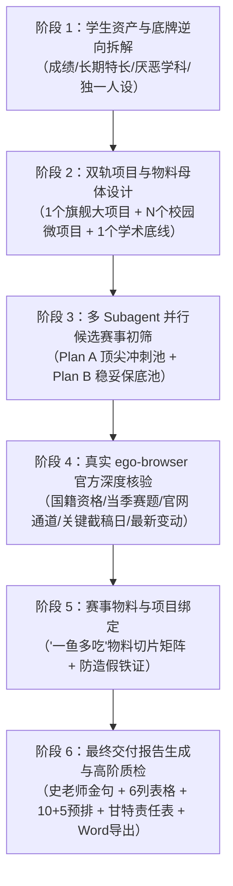

# 活动与竞赛精准挖掘、官方事实核查与最终报告生成手册（Activity & Competition Scout）

本技能用于为国际高中生（特别是美本 Top 30 / Top 20 申请者）进行**活动与竞赛精准挖掘、专业人设匹配、赛事实体物料转化、100% 官方真实资格核查，并最终编排产出高水准、客户立即可读可执行的《活动与竞赛规划实施方案（会后正式版 / 交付版）》Word 文档（.docx）及 Markdown 完整报告**。

---

## 核心交付价值与五大不妥协原则

1. **最终报告驱动（Report-Oriented Delivery）**：
   - 挖掘与核查不是散装笔记，最终产物必须是符合史老师（Laidong Persona）风格的客户正式交付级实施方案（包含段首决策金句、6列事实核查表、Common App 10大活动位、双周落地甘特表）。
2. **绝不盲目套用营销号推荐**：
   - 通过真实浏览器 `ego-browser` 深度核查官方 Eligibility 手册，坚决排除非美籍不可参赛、政策变更或停办重组的赛事。
3. **尊重学科红线，保护身心带宽**：
   - 严格尊重学生偏好（如学生讨厌物理，坚决不碰硬物理，转向真实体态、UI/UX、视频、艺术与逻辑交叉）；坚决避开闭卷题海式笔试，保全课内 GPA 与 SAT 备考精力。
4. **大项目自主组队先行，导师后置兜底分摊**：
   - 学生担任队长（Captain/Founder），顾问提供预提案武器，由学生在校内自主挑人，培养真正的领导力；复杂的硬件电路先摸底，遇卡点按需引入外部导师兜底，全队分摊成本，绝不让家庭提前硬扛高昂包袱。
5. **“一鱼多吃”与物料闭环**：
   - 赛事的提交物完全由设计好的项目自然生成，做一套扎实的作品，打通 Conrad、Technovation、CTB 等多级赛事，坚决不让学生“打一个比赛就重写一套完全不同的作业”。

---

## 核心工作流总览（The 6-Stage Pipeline）



---

## 阶段 1：学生资产与底牌逆向拆解

在推荐任何活动或比赛前，必须完整审计学生已有的所有文档与数据，提取以下 4 个底牌要素：

1. **学业基本盘与时间预算**：
   - 托福/雅思/SAT 考到多少分？（例如：托福已出 110，说明高十一可以节省成百上千小时的语培时间，允许投入高阶科研与活动）。
   - GPA 与已考 AP/IB 成绩（例如：已考 AP 微积分 BC 5分、AP CSA 在读，证明数理逻辑强，无需参加高压算法奥赛，欧几里得数学前 25% 即可证明理科硬核度）。
2. **长期坚持的特长资产（老树发新芽）**：
   - 挖掘坚持 5-10 年以上的专长（如芭蕾舞 RAD 高级证书、某项运动、视频剪辑数十万播放量、魔方速拧、学生会职务）。
   - **升维原则**：美本名校极度反感“全套外部生造包装”的塑料履历。必须将这些老经历升维为对真实问题的思考源头（例如：芭蕾训练中的足踝积液与假外开痛点 -> 催生具身智能防伤产品）。
3. **学科绝对红线（坚决不硬碰学生反感的科目）**：
   - 如果学生明确表示**讨厌物理或纯数学推导**，方案中严禁出现纯力学传感器、复杂硬件电路推导、理论物理建模或 USACO 算法死磕。
   - 将技术重心完全转移至：**真实用户痛点洞察、Figma UI/UX 交互原型、科技路演视频拍摄与剪辑、校园真实需求落地**。
4. **反向倒推申请独一人设（The Spike Persona）**：
   - 绝不走“千人一面”的纯 CS / 纯生化 / 纯商科赛道；
   - 锁定交叉学科标签，例如：`具身交互与运动科技产品官 (Embodied HCI & Somatic Sports-Tech PM)`。

---

## 阶段 2：双轨项目架构与物料转化设计（1 + N + 1 体系）

### 1. 核心旗舰大项目（1个 · 冲击全球顶尖大奖）
* **定位**：解决“专业深度”与“国际顶尖荣誉门槛”问题。
* **自主组队先行 · 导师后置兜底机制**：
  - **学生自主挑人（Captain/Founder）**：顾问团队协助准备 1 页纸《项目预提案与招募要点》，学生回校后主动向意向同学宣讲，在校内自主挑人组队，培养真正的领导力；
  - **学生核心职责**：痛点陈述、Figma UI/UX 设计、路演视频出镜与主导剪辑、答辩主陈述人；
  - **外部导师按需后置**：队伍组齐后先摸底技能池。若硬件电路或底层滤波遇到瓶颈，顾问团队引入专业科创导师把关，全队分摊指导成本，绝不提前给家庭增加高昂负担。
* **跨年级防撞期机制**：
  - 康莱德中国站决赛（明年 3 月中旬）极易与 3 月 SAT 考期撞车；
  - 队伍必须搭配跨年级队员（如初三/高一低年级弟弟或学长），确保答辩出勤率，为核心高十一队员的 SAT 腾出绝对安全窗口。
* **核心物料产出**：① 柔性鞋垫/硬件功能原型；② Figma 交互界面；③ 5页商业画布（Lean Canvas）；④ 3分钟科技发布会级 Pitch 视频。

### 2. 校园落地微项目（N个 · 顾问亲带 · 真实落地 · 文书血肉与防造假铁证）
* **定位**：解决“真实接地气”、“文书生动细节”与“防造假铁证”问题。每个仅占 1~2 个周末。
* **事权深度绑定**：顺应学生在校内的职务与平台（如学生会副主席统管组织部与学习部），顺水推舟将事权用透：
  - **微项目 ①【事权联动旗舰】**：`校园 Career Center 职业与专业探索中心`（学习部职能，邀请外部大咖与校友开展每周专业工坊，树立学术领导力）；
  - **微项目 ②【数字体验创新】**：`万圣节化装舞会数字化系统`（组织部职能，用 Figma 设计匿名标签匹配与抽奖系统，解决现场混乱痛点）；
  - **微项目 ③【健康行动落地】**：`BodyTech 校园压力舒缓与体态工坊`（大项目芭蕾动作降维，结合 50 人调研数据直接转化投递 CTB 创新行动类）；
  - **微项目 ④【同理心说明书】**：`AlgoGuide 魔方三维空间图解手绘小册子`（将算法逻辑翻译为视觉手绘，证明极致同理心与交互教学能力）。

### 3. 学术标化赛事（1个 · 团队建模替代题海笔试）
* **定位**：坚决放弃闭卷高压刷题笔试（如欧几里得不作为主打，避免与 SAT 冲突）；
* **战略转向**：主攻 **HiMCM（美国高中生数学建模竞赛）**。11 月中旬开赛，13~14 天开放窗口期，4 人组队论文提交制，允许导师合规辅导。结合微积分 5 分与 Python 数据清洗专长，11 月底结项交卷，寒假前锁定国际大奖。

---

## 阶段 3：多 Subagent 并行候选赛事挖掘

针对不同赛道，使用 `invoke_subagent` 派发并行研究任务，分别摸排：
1. **Plan A 顶尖科技与商业创新赛事**（Conrad Challenge, Technovation Girls, Imagine Cup Junior 等）；
2. **Plan B 稳妥高性价比全国/全球中级奖**（CTB 创新行动类, Diamond Challenge 等）；
3. **学术竞赛**（HiMCM 建模, 欧几里得等）。

Subagent 汇报时必须明确标注：主办方、参赛费用（是否免费）、组队形式、历史获奖比例。

---

## 阶段 4：真实 ego-browser 官方深度事实核查（必须执行）

> **【不可违背铁律】**
> 严禁仅凭国内留学中介宣传软文或百度/小红书二手信息做规划！必须使用 `ego-browser` 直接访问赛事官方网站（.org / .edu / 官方报名系统），检索当季最新《参赛规则（Rules & Guidelines）》与《常见问题（FAQ）》。

### 官方事实核查必查 6 大核心维度清单：
1. **资格与身份铁门槛（Eligibility & Citizenship）**：国籍限制（排查非美籍不可参赛陷阱）、学籍与地域限制、年龄与年级窗口、组队人数与教练要求；
2. **最新赛道与赛题设置（Tracks & Categories）**：今年最新开放赛道，是否契合学生专长且避开反感科目；
3. **官方报名流程与渠道（Registration Channels）**：全球独立官网直投 vs ASDAN 等代理；收费还是 100% 公益免费；
4. **当季确切时间节点（Timeline & Deadlines）**：注册日、Phase 1/2 提交日、答辩日、出成绩公布月份（确保在 Common App 递交前奖项实打实落袋）；
5. **评审标准与核心提交物（Judging Criteria & Deliverables）**：视频时长限制（2-3分钟）、商业计划书页数限制（3-10页）、原型要求（允许 Figma 还是必须有硬件实体）；
6. **历史变动与政策陷阱（Reorganizations & Risks）**：排查近 2 年是否存在代理权变更、停办重组等风险（详见 `references/disqualification-blacklist.md`）。

---

## 阶段 5：赛事物料与项目绑定（“一鱼多吃”与防造假闭环）

在方案中必须讲清**“为什么不需要做多份作业”**以及**“为什么这些小项目是文书与答辩的杀手锏”**：

### 1. 大项目物料切片矩阵（一套成果打通三大赛）
* **母体**：`BalletSense 智能足踝防伤系统`（柔性鞋垫硬件 + Figma App + 3分钟路演视频 + 商业画布）。
  - **切片 1 投 Conrad**：5页商业画布 + 3分钟 Pitch 视频 + Figma 录屏。
  - **切片 2 投 Technovation**：Figma 原型打包 + 5-10页商业计划书 + 视频切成 3-4 分钟 Pitch + 2 分钟技术演示（100% 免费复用）。
  - **切片 3 投 Imagine Cup Jr**：微震动与姿态识别提炼为 AI for Health，套入微软官方 10-12 页 PPT 模板，录制 2 分钟音频顺手投递。

### 2. 小项目直通 CTB 与防造假铁证
* **小项目 ③ 投 CTB**：50 人筛查真实数据 + 舒缓操前后对比反馈，直接生成 CTB 创新行动类结项报告，2 月底答辩。
* **小项目 ②/④ 防造假铁证**：大学面试官质询大项目是否中学生独立完成时，拿出自己写的轻应用与手绘说明书，直接打消评委对动手能力的疑虑；同时真实填满 Common App 活动列表第 4、5、6 项。

---

## 阶段 6：最终交付报告（Word/MD）生成与高阶质检

本阶段是将前面的所有调研成果、项目构架与时间节点，编译为家长和学生直接落地执行的正式成果。

### 1. 最终交付版报告的标准 8 章节规范
详见 [references/final-report-structure-guide.md](references/final-report-structure-guide.md)：
- **封面与档案头信息**：会后正式版标识、档案元数据（GPA/SAT免战状态/人设定位）；
- **第 0 章：全局战略提要与核心决议**（置顶史老师 Lead Quote 决策金句 Callout 框）；
- **第 1 章：学生底牌资产与独一人设定位**（老树发新芽、偏科保护、HCI 交叉人设）；
- **第 2 章：核心旗舰大项目实施方案**（自主组队先行、导师后置兜底与成本分摊、跨年级防撞期）；
- **第 3 章：学术与标化竞赛实施方案**（HiMCM 建模论文替代闭卷题海笔试）；
- **第 4 章：校园落地微项目矩阵**（事权绑定、1大+N小闭环、反造假铁证）；
- **第 5 章：精选赛事 100% 官方事实核查与物料直通全景表**（标准 6 列规范）；
- **第 6 章：Common App 10大活动位与5大荣誉预排系统**（提前锚定高三申请表）；
- **第 7 章：双周落地推进甘特与行动责任矩阵**（按周明确艾馨动作、顾问动作、交付物）。

### 2. 史老师文风（Laidong Persona）表达要求
详见 [references/report-persona-voice.md](references/report-persona-voice.md)：
- **段首必带 Lead Quote**：每章开头置顶 150-200 字通透犀利的结论，用浅青色背景（#F0F7F6）左粗竖线（#00685F）Callout 框承载；
- **坚决剔除中介黑话**：禁止“赋能、画像、闭环、抓手、对齐、综上所述”；
- **会后交付版去公关化**：严禁出现“对妈妈沟通话术”、“排除某某比赛”等消极字眼。

### 3. Python 自动化报告生成脚本
本技能内置工业级 Word 渲染引擎：`scripts/generate_scout_report.py`。

```bash
# 1. 导出标准 JSON 数据模板进行填充
python scripts/generate_scout_report.py --export-sample report_input.json

# 2. 生成会后正式版交付 Word 文档（直接给家长与学生）
python scripts/generate_scout_report.py --input report_input.json --output "陈艾馨-2028Fall-活动与竞赛规划实施方案（会后正式版）.docx" --mode post_meeting

# 3. 生成会前准备版提纲（顾问内部沟通用）
python scripts/generate_scout_report.py --input report_input.json --output "陈艾馨-2028Fall-活动与竞赛规划沟通提纲（今日会议专用）.docx" --mode pre_meeting
```

### 4. 交付前 10 项终审质检清单 (Quality Checklist)
- [ ] 1. 全文无任何生硬中介黑话（赋能/抓手/画像/闭环）。
- [ ] 2. 交付版中文档无任何“排除某赛事”字样。
- [ ] 3. 交付版中文档无任何内部备忘或公关话术。
- [ ] 4. 第 0 至第 7 章均包含淡青色段首决策金句（Lead Quote）。
- [ ] 5. 大项目明确“自主组队先行 + 顾问提供弹药 + 导师后置兜底分摊”三层推进机制。
- [ ] 6. 明确跨年级队伍架构，防范 3 月康莱德决赛与 3 月 SAT 撞期。
- [ ] 7. 学术竞赛转战 HiMCM 团队建模论文，彻底卸下高压题海负担。
- [ ] 8. 赛事全景表 6 列完整无缺（含最新官方 URL 与物料映射）。
- [ ] 9. Common App 10大活动与5大荣誉预排完整。
- [ ] 10. 双周甘特责任表包含周次、学生动作、顾问动作与验收成果。

---

## 关联参考文档与脚本

- [references/final-report-structure-guide.md](references/final-report-structure-guide.md)：完整 8 章节规范、会前/会后区别与质检清单
- [references/report-persona-voice.md](references/report-persona-voice.md)：史老师（Laidong Persona）咨询文风与表达指南
- [references/ego-browser-verification.md](references/ego-browser-verification.md)：真实的 ego-browser 自动化核验代码模板
- [references/disqualification-blacklist.md](references/disqualification-blacklist.md)：美本竞赛官方资格红黑榜（排查非美籍不可参赛陷阱）
- [references/deliverable-mapping-matrix.md](references/deliverable-mapping-matrix.md)：大小项目成果与赛事物料映射转换矩阵
- [scripts/generate_scout_report.py](scripts/generate_scout_report.py)：活动与竞赛规划 Word / MD 最终报告自动生成脚本
- [scripts/factcheck_checklist.py](scripts/factcheck_checklist.py)：单项赛事 100% 官方事实核验清单生成器
